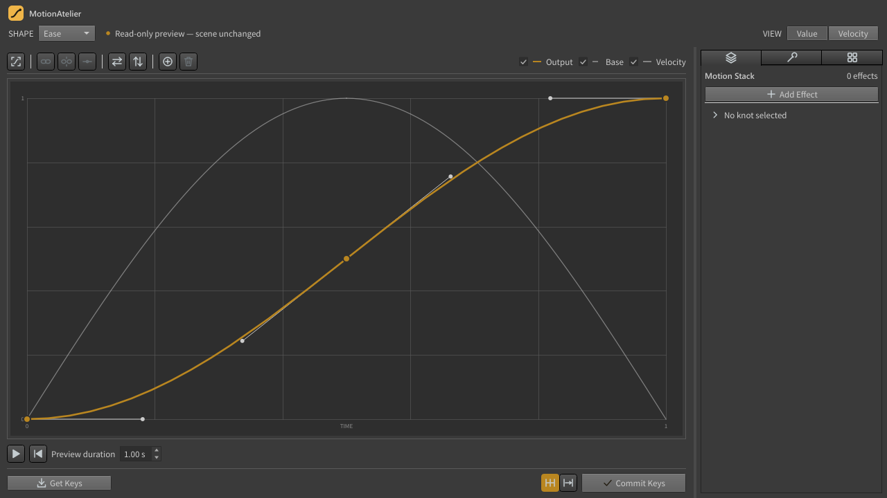
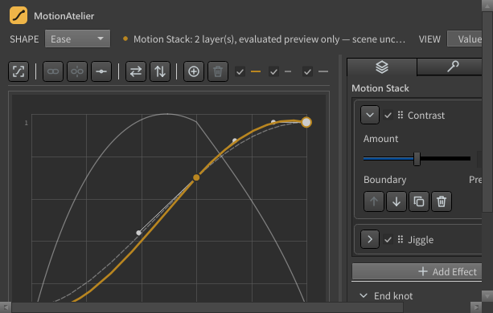
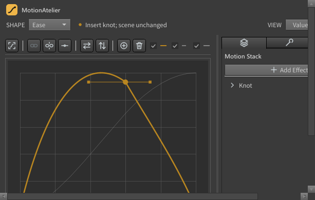
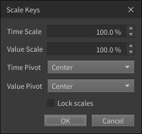
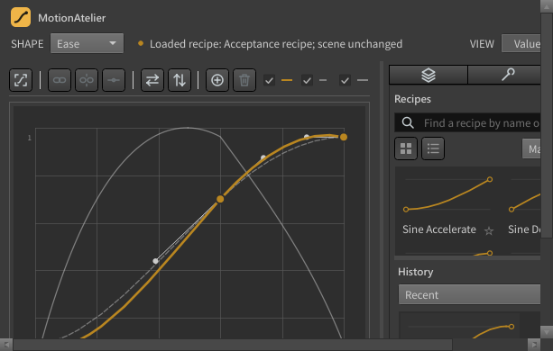

# MotionAtelier

A free, open-source animation-curve panel for **SideFX Houdini 20.0 – 22.0** (Windows).

Read selected keyframes into an editable curve — or start from a procedural Bounce, Elastic,
Wave or Noise shape — refine it, layer non-destructive effects, preview it, and commit it back
onto any number of channels as a small set of native Bezier keys, in **one Houdini undo step**.

Current version: **0.4.3**. Download it from the
[Releases](../../releases/latest) page.

## Features

- **Get Keys** from the Channel Editor or playbar selection into a normalised Ease curve.
- **Ease editor:** knots and tangent handles, marquee and Shift selection, fine adjustment,
  smooth / break / flatten, flip time and value, insert and delete, a right-click menu, a knot
  inspector (double-click a knot), local undo per shape.
- **Velocity view:** edit speed and influence directly; Output / Base / Velocity overlays.
- **Generators:** Bounce, Elastic, Wave, Noise — exact, sparse curves from a few parameters.
- **Motion Stack:** Contrast, Arc Bias, Noise, Gaussian Smooth, Sharpen, Jiggle, Spring, Lag,
  Delay as non-destructive layer cards with mix, reorder and per-layer preview; committed
  through a sparse fitter, never baked.
- **Safe commits:** each interval or whole range; boundary keys keep their times and values;
  keys outside are never changed; every write is read back and verified; any failure
  restores every channel.
- **Key Tools:** Inspect Selection, Remove Interior / Outside Keys, Reduce Keys, Scale Keys,
  Offset Channels, Shift Following Keys, Match Durations, Align Starts / Ends.
- **Recipes:** 32 factory recipes, a tile grid with search, sort, favourites and drag reorder,
  export and import with a per-recipe review, and a **History** of every committed curve.
- **Preview** marker with play, restart and duration.

| Motion Stack | Velocity view | Key Tools dialog | Recipes and History |
|---|---|---|---|
|  |  |  |  |

## Install

1. Download `MotionAtelier-<version>.zip` from [Releases](../../releases/latest) and close
   Houdini. If an older MotionAtelier is installed, delete its `MotionAtelier` folder first
   (0.4.0 changed the folder layout).
2. Copy the contents of the archive's `packages` folder (`motion_atelier.json` and the
   `MotionAtelier` folder) into your Houdini user packages folder, for example
   `%USERPROFILE%\Documents\houdini21.0\packages\` (or `houdini20.5`, `houdini22.0`, …).
3. Start Houdini and open **MotionAtelier** from a pane's **+** menu (Python Panel
   interfaces).

Requirements: Houdini 20.0, 20.5, 21.0 or 22.0 with its own Python and Qt (one package for all:
Python 3.10 – 3.13, PySide2 or PySide6). Other versions skip the package. Nothing else — no
network access, no licence checks, no telemetry.

| Houdini | Python | Qt binding | Tested |
|---|---|---|---|
| 20.0 | 3.10 | PySide2 | not tested (same Python and binding as 20.5) |
| 20.5 | 3.10 / 3.11 | PySide2 | 20.5.445 |
| 21.0 | 3.11 | PySide6 6.5 | 21.0.792 |
| 22.0 | 3.13 / 3.11 | PySide6 6.8 | 22.0.429 |

Copy the package into each version's `packages` folder you use. Recipes, history and settings
are kept per Houdini version (in that version's preference folder).

To uninstall, delete `motion_atelier.json` and the `MotionAtelier` folder from the packages
folder, and the `MotionAtelier` folder in your Houdini preference directory to remove your
recipes, history and settings.

## Quick start

1. Select two keys of a move in the Channel Editor.
2. Press **Get Keys** — the motion appears in the Ease curve.
3. Drag the handles (**VIEW ▸ Velocity** shows speed), or pick a shape such as **Bounce**.
4. Press **Commit Keys**. Houdini's **Edit ▸ Undo** reverts it in one step.

## Licence

**GPL-3.0-or-later with the MotionAtelier Houdini Integration Permission** — the GNU GPL
version 3 or later ([LICENSE](LICENSE)) plus a section 7 additional permission
([HOUDINI_EXCEPTION.txt](HOUDINI_EXCEPTION.txt)) that lets MotionAtelier be combined with
SideFX Houdini through its plugin interfaces (`hou`, Python Panels, its bundled PySide) and
conveyed for that use, without the GPL claiming any part of Houdini.

- You may use, study, modify, share and sell MotionAtelier, commercially or not. If you
  distribute it, modified or not, you must provide its source under the same terms.
- Animation you make with MotionAtelier is yours; the licence does not cover it.
- Houdini stays under SideFX's licence; this licence grants no rights in Houdini.

The complete source is the readable Python in [packages/](packages/), identical to the
release archive. MotionAtelier is not affiliated with SideFX.
